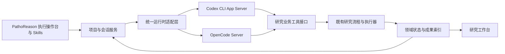

# PathoReason 执行计划

版本：v0.8  
日期：2026-10-30  
状态：**P0–P4 已完成（P2 为独立合成 MIL 闭环，P3 为双环境上下文兼容，P4 为领域 Schema 与历史只读适配）；P5 正式试验入口已交付，真实端到端验收待新窗口开展。**  
项目根目录：`bxn-server:/home/bxn/projects/PathoReason`

## 一、已确认的产品目标

1. PathoReason 为系统正式名称。
2. 研究工作台退为阶段追踪、成果可视化、预览和下载平台。
3. 独立执行操作台承载对话与执行：左侧工具和项目/会话，右侧人与 Agent 的对话、执行过程和历史。
4. 最左侧单独一列固定执行操作台、研究工作台和工具三个入口；项目空间另占一列，右上角支持向左折叠；工具内按研究类别一级、实际流程顺序二级组织 Skill，显示能力与可用状态（2026-10-30 用户修订）。
5. 对话和执行期间可随时切换研究工作台，返回时保留当前会话、草稿和运行状态。
6. 服务器主要使用 OpenCode + DeepSeek 开发验收；Codex 开发验收只在本机进行；服务器保留 Codex 登录接口。统一适配层继续支持自选基模。
7. 原有研究流程先保持；梳理原 Schema 后，再按明确版本和迁移方案调整。
8. 先保存执行计划，之后逐步开发。

## 二、当前基础与证据

- 旧实现：`/home/bxn/projects/auto-research`。既有单次任务适配包含 Codex、OpenCode 等；持续会话能力仍需新增适配。
- 已有交互演示：`http://100.84.214.106:8514/agent-demo.html`，仅前端模拟；不代表真实引擎已接入。
- 上一轮实际核对：Codex CLI 0.164.0、OpenCode 1.18.33；Codex 原生协议中存在创建/恢复会话、发送/中断回合、Skill/模型列表和压缩接口。后续实施前重新核验安装版本。
- 原 Schema 涉及实验配置、任务语义、流程模板、能力、执行账本、研究预算、助手记忆与前端类型；并非只修改 schema.py。
- 现有 OpenCode 单次调用没有绑定持久 session，默认隔离 HOME/XDG 为临时存储，自定义模型元数据未完整声明上下文限额。多轮延续和压缩需要专门接入。
- 上轮取证目录：`/data/bxn/auto-research/acceptance/agent-console-planning-20261030`，包含静态契约清单、OpenAPI 快照与实际 Codex 协议。
- 两份原规划文档已按原字节复制到 docs/references/；来源路径与 SHA256 见 provenance.json。它们是参考快照，实施进度以本计划及后续记录为准。

初次落盘仅创建文档。随后 P0 已建立独立契约代码、开发环境和验证入口；未启动新应用、迁移旧数据、接入真实推理或改变旧服务。

## 三、总体实施边界

推荐结构：



- 项目、会话、执行回合、工作流实例和训练单元分别建模；不假设一个会话就是一个实验。
- 浏览器通过应用服务连接 Agent。应用保持原生 session/thread 绑定；刷新与断线不重新发起同一任务。
- 研究工作台从业务状态和成果索引读取进度；Agent 的“已完成”文字不能直接推进阶段。
- 原有单次产物 runner 先保留；新增长期会话适配器，避免同时重写全部执行链路。
- 正式阶段从流程模板/冻结实例生成；原演示的 CESC 十阶段不作为全局硬编码。
- 科研流程修改、预算变化、执行授权和历史事实保留原契约；必要交互移到对话内，不新增例行逐步确认。
- 停止 Agent 回合与停止后台研究作业分别处理；切换页面不终止作业。

## 四、阶段与完成标准

### P0：项目基线与契约定稿

状态：**已完成（2026-10-30）**。项目/存储/源码复用边界已确定，16 个契约 Schema 与真实来源样例通过验证。交付见 [P0 实施记录](docs/p0/IMPLEMENTATION.md)。

P0 历史预检发现服务器 Codex 未登录。按用户最新修订，服务器转为 OpenCode + DeepSeek 主线，本机承担 Codex 真验收；服务器 Codex 登录不再是 P1 前置条件。见 [环境修订](docs/PLAN_REVISION_RUNTIME_20261030.md)。

交付：

- 决定新目录如何引用或移植旧源码：列出模块范围、依赖、许可、修改边界；不默认整仓复制。
- 确定应用结构、包管理、版本控制方式、开发/发布端口与独立数据目录；避免旧服务端口冲突。
- 对选定首轮场景追踪输入 → 业务对象 → 执行 → 持久化 → 展示的字段流。
- 定义最小 ResearchProject、SkillDefinition、Conversation、Turn、RuntimeBinding、ContextSnapshot、ArtifactIndex 与事件契约。
- 为旧实验/项目提供 LegacyResourceRef 映射，记录 adapter、id、revision，保留旧身份。
- 固定运行时版本及兼容协议；明确测试模型/认证方式与实际调用预算。

验收：样例通过契约校验；字段的单位、权威来源、版本、状态含义和兼容策略明确；没有改写旧数据。

### P1：服务器 OpenCode + DeepSeek 真实会话与 Skills 入口

状态：**已完成（2026-10-30）。** OpenCode + deepseek-v4-pro 真会话、Skill、流式、停止、断流/重启恢复、成果引用与隔离通过；见 [P1 真验收](docs/p1/LIVE_VALIDATION.md)。

交付：

- 使用 PathoReason 名称建立前端；左侧工具、Skills、项目和会话；右侧对话、输入框与执行过程。
- 工具目录按研究类别 → 流程阶段组织 Skill，显示说明与环境可用性；已接入 Skill 进入当前对话。排障恢复标为贯穿阶段。
- 接入服务器 OpenCode Server + DeepSeek，固定 project/conversation 与 native session 的绑定；精确型号、服务地址、凭据和工具支持在接入时核对。
- 建立持久 session 存储、模型窗口/用量元数据、基础压缩配置和失败提示；未知窗口不显示虚假的精确占比。
- 服务器设置页保留 Codex 登录状态、发起登录、取消/失败反馈及重新检查入口；未登录不影响 OpenCode 主线。
- 持久保存消息和公开执行事件，支持流式回复、明确停止、历史恢复、模型选择和成果引用。
- 基模/运行配置按回合保存快照；切换只影响后续回合。

首轮推荐场景：基于已有 CESC 成果进行解释与引用，产出可查看的研究摘要，不引入新训练。

验收：服务器真实 OpenCode + DeepSeek 响应；Skill 正确加载；引用定位原成果；刷新、断流、进程恢复和视图切换保持会话；项目隔离；停止返回明确状态；不重复执行；基础上下文/压缩状态可见；Codex 登录入口及未就绪提示可用。服务器不以 Codex 登录或推理成功为条件，本机 Codex 真实兼容验收单列 P3。本阶段不等于研究业务闭环完成。

### P2：对话驱动已有研究流程

状态：**已完成（2026-10-30，独立 CPU 合成 MIL 闭环范围）**。真实 OpenCode + DeepSeek 完成接入、方案、反馈修订、确认执行与成果回引；幂等、旧版本拒绝和失败恢复通过。旧真实实验保持只读。见 [P2 实施记录](docs/p2/IMPLEMENTATION.md) 与 [验收记录](docs/p2/VALIDATION.md)。

交付：

- 将已有任务接入、方案、执行、反馈修订和恢复能力接到业务工具接口。
- 行动携带 target、expected_revision 和幂等键，沿用原工作流、预算、完整矩阵与门禁检查。
- 研究工作台提供总览、阶段和成果视图；把执行操作转移至对话，保留原事实来源。
- 建立领域事件与运行时事件映射，区分回合完成、工具成功、流程完成与科学判断。
- 成果索引支持图表、文档、下载、回到对话讨论；数据和文件按项目/运行归属关联。

验收：独立合成小任务完成一次“对话要求 → 业务执行 → 阶段更新 → 产物展示”闭环；重复请求不重复派发；意见能形成可核验修订；异常可定位并按既有范围恢复；不启动或修改旧真实实验。

### P3：本机 Codex 兼容、自选基模与上下文增强

状态：**已完成（2026-10-30）**。本机 Codex 两型号、服务器 DeepSeek 真调用、原生压缩、停止/恢复、窗口检查和跨环境成果交接通过。服务器继续承担 P2 业务执行；本机核对 Skill 与只读研究工具，不启动科研训练。见 [P3 实施](docs/p3/IMPLEMENTATION.md)、[验收](docs/p3/VALIDATION.md) 和 [P4 Schema 输入](docs/p3/SCHEMA_IMPACT.md)。自动压缩采用独立验收阈值，未开展百万 token 满窗压力测试。

交付：

- 在本机接入 Codex App Server，复用前端与公共契约，完成真实会话、事件、取消、恢复和 Skill 加载验收；服务器继续以 OpenCode + DeepSeek 为主。
- 建立本机独立配置、数据目录和证据记录；重新核对本机版本/登录/模型，不复用服务器凭据或 native session ID。
- 基于 P1 OpenCode 持久存储，核对两类引擎各自原生存储与应用绑定，保持项目和环境边界。
- 建立 ModelDescriptor：provider/model、context/input/output 限额、工具支持、用量来源与配置就绪状态。
- 在 P1 基础上下文管理上验证自动/手动压缩、长历史与失败恢复；明确工具输出裁剪和摘要压缩的区别。
- 分离浏览器历史、模型上下文、研究事实；压缩后可从项目约束、决定和成果来源重新取数。
- 同一引擎切换模型检查窗口与工具兼容；跨引擎创建新原生会话，通过快照交接并显示历史分界。

验收：服务器 OpenCode + DeepSeek 与本机 Codex 分别真实验证；至少两种已配置模型的真实调用（注明引擎/环境，不冒称同一引擎切换已通过）；多轮与进程重启恢复；自动/手动压缩；切换更小窗口；上下文限额未知/摘要失败/断流处理；保留关键研究约束与成果引用；压缩后不重放已经执行的动作。模型费用与 token 统计口径明确，不把累计用量当当前窗口占用。

### P4：领域 Schema 调整与历史兼容

状态：**已完成（2026-10-30）**。版本化领域投影、统一引用、来源链、上下文/调用策略、新旧交接兼容和旁表迁移回退通过；未改写原科研记录。见 [P4 实施](docs/p4/IMPLEMENTATION.md)、[Schema 变更](docs/p4/SCHEMA_CHANGES.md)、[验收](docs/p4/VALIDATION.md) 与 [迁移回退](docs/p4/MIGRATION.md)。旧 repair 历史仅夹具验证，实际旧审阅只读映射。

交付：

- 明确 TaskSpec 与 ExperimentConfig 旧字段的权威关系；拆分研究语义、计算设置、调用策略与预算视图。
- 根据实际需要分离流程定义与展示投影，保持冻结模板实例可读。
- 对稳定的新公共契约生成前端类型，逐步减少 Python/OpenAPI/手写 TS 的重复定义。
- 每项 Schema 变更给出旧/新版本、生产者/消费者、读写路径、迁移或适配函数、回退路径。
- 历史数据优先只读映射；需要变化时创建明确新修订，不隐式重写旧哈希或科研记录。

验收：代表性旧实验与项目读取不丢字段；冻结来源不变；新旧结果解释一致；迁移失败可回退；旧排障历史导入标记 legacy，不冒造原生会话。

### P5：整体验收与正式切换

状态：**入口已交付，正式端到端验收待新窗口（2026-10-30）**。按用户要求，本窗口交付 OpenCode + DeepSeek + Seedream 服务器入口，迁移原有 Skill，沿用原仓库数据接口和图像配置；不在本窗口发起真实试验。见 [操作入口](docs/p5/OPERATOR.md)、[入口验证](docs/p5/ENTRY_VALIDATION.md)、[下一窗口](docs/p5/NEXT_WINDOW.md) 和 [发布恢复](docs/p5/RELEASE_RECOVERY.md)。

交付：版本化发布、运行说明、恢复说明、数据备份与回退记录；明确哪些旧入口保留及正式入口的访问方式。

验收：选定真实研究场景端到端通过；项目/会话/Skill/成果关联正确；运行中断线与恢复通过；数据和来源核验通过；部署版本可追溯。正式切换范围及旧服务处理在该阶段单独明确，本计划不构成现在停止或删除旧服务的指令。

## 五、Skill 分类与可用性原则

首批候选：数据接入与任务定义、病理 MIL 基线研究、机制与消融研究、结果解读与汇报、研究成果转论文、图件与排版、实验排障与恢复。

当前 7 类场景归入病理 MIL 研究并按流程排列；未来分割等类别可单独加入。此目录不替代冻结研究流程。目录展示的是产品场景；SKILL.md、流程模板、能力端口、执行器分别作为实现依赖。每项独立记录 implementation_status、evidence_scope、runtime_readiness 与 unavailable_reason。已有受限模型/任务组合和暂缓功能继续按事实展示；目录出现不自动开放新功能。

SkillInvocation 固定技能版本和摘要；历史会话不会因目录更新自动变更行为。

## 六、Schema 最小关系

```text
ResearchProject
  ├── Conversation → Turn → MessagePart / RuntimeEvent
  │     └── RuntimeBinding → Codex thread 或 OpenCode session
  ├── SkillInvocation → SkillDefinition 固定版本
  ├── WorkflowInstance / LegacyResourceRef → 既有业务记录与账本
  ├── ContextSnapshot → 目标、约束、决定、待办、来源引用
  └── ArtifactIndex → 真实产物、运行来源、阶段与验证范围
```

ExecutionIntent 关联会话回合和业务目标，包含 expected_revision 与 idempotency_key。DomainEvent 表示实际业务变化，与 RuntimeEvent 分开保存。所有新契约使用独立 schema_version；具体存储结构在 P0 决定。

## 七、决策与后续事项（P0 更新）

| 事项 | 当前建议 | 定稿阶段 |
|---|---|---|
| 新旧源码关系 | 已定：独立仓库、选择性前端迁移、旧业务适配；清单见 P0 REUSE_MAP | P0 完成 |
| 项目粒度 | 已定：一个研究项目包含多个会话、实验和稿件 | P0 完成 |
| 新运行数据位置 | 已定：/data/bxn/PathoReason；config/pathoreason.local.json | P0 完成 |
| 自定义 Skill | 已定：首版病理 MIL 类别下 7 个 Skill，按流程组织；P1 已接结果解读 | P1 实现 |
| 真实验收账户和模型 | 服务器 OpenCode + deepseek-v4-pro 真验收通过，费用以供应商账单为准；本机 Codex 在 P3 | P1 服务器主线，P3 本机兼容 |
| runtime 跨引擎切换 | 新会话绑定 + 项目快照交接，保留历史分界 | P3 |
| 领域 Schema 变更范围 | 以真实场景暴露的需求形成逐项变更清单 | P0/P4 |
| 正式部署入口与旧入口 | 新版本验证通过后再确定切换方案 | P5 |

## 八、执行记录与维护

所有阶段遵循 [通用开发与能力验证规则](docs/DEVELOPMENT_PRINCIPLES.md)。系统缺陷应在运行时、工具、Skill 或公共机制中修复；真实任务验收由目标引擎与基模完成，开发者代改的研究成果不能计为系统自主完成证据。工程、原生集成、模型行为及科学审核分别记录。

- [x] 创建 PathoReason 项目目录并确认正式命名。
- [x] 保存本执行计划、原规划和 Schema 盘点快照。
- [x] P0 项目基线与契约定稿（54 项测试、14 项兼容检查）。
- [x] P1 服务器 OpenCode + DeepSeek 真会话、分类 Skills 与 Codex 登录入口（71 项回归；6 个真实回合、流式/停止/恢复通过）。
- [x] P2 对话驱动研究流程（独立合成 MIL 闭环）。
- [x] P3 本机 Codex 兼容、自选基模与上下文增强。
- [x] P4 Schema 调整与历史兼容。
- [x] P5 入口交付：独立正式项目、原有 Skill、数据/Seedream 适配、发布与恢复资料。
- [ ] P5 真实研究端到端验收与正式切换（用户另开窗口）。

每阶段开工记录基线、变更范围和验收输入；完成后记录实际结果、测试证据、局限及后续事项。计划变化用版本修订保留原因，不把已完成演示或静态协议检查写成真实执行验收通过。

2026-10-30：用户授权 P0 后完成契约、环境和兼容验收；后续从 P1 开始，以服务器 OpenCode + DeepSeek 接入真实会话；服务器保留 Codex 登录入口，本机 Codex 验收单列。P0 没有提前实施 P1–P5。

修订记录：v0.1 初次计划落盘；v0.2 根据 P0 实机实现更新交付与决策，原参考快照未改写。

v0.3：按用户要求调整为服务器 OpenCode + DeepSeek 主线、本机 Codex 验收，提前持久 session 与基础上下文接入。服务器 Codex 未登录不阻塞主线；P0 实测证据不改写。

v0.4（P1 实施更新）：用户授权继续 P1，已交付前后端、原生会话适配、持久化、7 类 Skill 入口、成果预览与 Codex 认证接口。67 项后端测试、生产构建、11 项浏览器检查、6 项无推理原生协议检查通过。模型调用 0；P1 勾选保持未完成，待用户稍后配置 DeepSeek 凭据后进行真会话验收。

v0.5：按用户要求改为左侧三入口与研究类别/流程二级 Skill 导航。用户配置凭据后，完成 P1 真实会话与故障边界验证；结果见 docs/p1/LIVE_VALIDATION.md。P2–P5 未提前开展。

2026-10-30 导航细化：按用户指定的原 demo，导航窄栏与项目空间拆为独立两列，项目空间支持折叠/展开及刷新记忆。仅前端调整，验证见 docs/p1/NAVIGATION_LAYOUT.md。

2026-10-30 设计规范统一：用户指定 design.md 为长期界面依据。已集中基础 token 和语义状态映射，提高正文/辅助文字对比度与字号，保留三列及折叠结构；详见 docs/p1/DESIGN_UNIFICATION.md。

2026-10-30 P2：完成合成 MIL 对话业务闭环，保留原矩阵、预算、门禁、回执与恢复账本。真实任务 8/8 单元、4 份成果；故障恢复不重复派发。设计规范加入减少微文案、可访问性与操作后果要求，界面同步执行。真实数据训练、多运行及完整论文/机制业务未由本次合成验收自动开放。

2026-10-30 P4：完成领域 Schema 和历史兼容。新研究语义、计算设置、调用策略、预算和流程投影分离，旧源字段与摘要保持。服务器 12/本机 6 条历史上下文写入可撤销旁表；成果来源、多跳交接和旧引用解析已接入。104 项回归与六种浏览器布局通过；未新增模型或训练调用；P5 未开始。

2026-10-30 v0.8：按用户要求拆分 P5 入口交付与下一窗口真实试验。迁移 13 个原 Skill（2537 个原文件及资源），新增正式项目独立预算、原生命令确认、数据/Seedream 单次适配和带来源的成果登记。工程验证不代替真实科研验收；旧服务、历史预算和源记录保留。

2026-10-30 P5 权限增量：用户授权增加并部署会话 permission 设置，提供逐次确认、自动批准、自定义工具规则和本会话同类审批。此变更不推进真实科研端到端验收状态；独立验证范围、发布与限制见 docs/p5/PERMISSIONS.md。

## 2026-10-31 思考强度切换

用户要求增加思考强度切换；已实现 DeepSeek 关闭/低/高/最高四档、模型与对话偏好、回合配置冻结及原生 variant 传递。后端 127 项通过、1 跳过，前端构建、三宽度浏览器与 OpenCode 对本地模拟上游的参数验证通过。无新增真实模型调用或研究任务。发布与限制见 [REASONING.md](docs/p5/REASONING.md)。

## 2026-10-31 P5 增量：留出法方案修订

已完成固定留出法/CV 的显式方案契约、兼容检查与对话 Skill 适配，并由同一 OpenCode + DeepSeek 项目生成 v6 完成真实行为验证。交付与范围见 [留出法支持](docs/p5/HOLDOUT_SUPPORT.md)。这是方案层的能力验证，P5 实际训练与科学审核状态不据此变为完成。

## 2026-10-31 P5 增量：自然语言交互适配

已补充上下文优先级、默认草案推进、短确认和聚焦澄清规则，并为正式研究提供校验过的有界附件摘录。工程 201 通过、1 跳过；真实模型短句验收为部分通过，保留上下文污染、过度探索和预算超时。详见 [交互验证](docs/p5/CONVERSATIONAL_INTERACTION.md)。独立预算已耗尽，后续补验需另行明确并保存有界预算；不修改旧账本，也不将未测场景计为通过。P5 科研端到端状态不变。

## 2026-10-31 任务节点交互

服务器 0.6.9-p5-guidance：明确修改直接形成新草案；模型可提交关键选择/下一步按钮，点击创建正常回合，携带原提议与成果，保留自由输入。clarify/inspect 选择分别收紧为仅对话/只读运行时权限；plan 沿用原工具设置，非训练授权。事务、预算、重复点击与失效检查共同约束状态推进。详见 [任务节点引导](docs/p5/TASK_GUIDANCE.md)。

213 项测试通过、1 跳过；三宽度浏览器与真实 OpenCode + DeepSeek 交互验证完成。独立合成项目 9/12 回合、1090.493958/1200 秒，包括初版越界尝试的中断及审批等待，旧账本不重置。短句减少种子、方向选择接起草、只读检查已实际执行；过度探索、长回复、次要成果登记失败保留为限制。唯一提议短确认、更多数据、冻结划分修改未补验，科研端到端状态不变。原研究 1701 个文件 SHA 未变，未人工修改模型输出。

## 2026-10-31 硬件监控与显卡选择发布

统一整合 side 进程交接，服务器版本 0.6.10-p5-hardware。硬件页只读展示 CPU/内存/NVIDIA GPU 指标，可见时轮询；正式对话下方按 UUID 选择后续新计算任务的显卡。选择生成独立 compute 快照，冻结进新回合，compute_exec.py 启动入口设置 CUDA_VISIBLE_DEVICES 与 AUTORESEARCH_COMPUTE_CONFIG。原项目模板、运行中任务、授权和预算不改；选择不预留资源，也不是 GPU 沙箱。已有模板索引/UUID 不一致时由界面提示重新选择，不在发布时代改。

保留 0.6.9 Guidance、范围权限及恢复入口；契约从最终合并代码重生成，历史快照保留。最终 221 项测试通过、1 跳过，TypeScript/Vite 构建通过；浏览器和发布证据见 [硬件功能](docs/p5/HARDWARE.md) 及 /data/bxn/PathoReason/acceptance/hardware-20261031/main-integration。无模型调用或真实训练；当前为工程/集成验收，模型选用启动入口与真实 GPU 训练尚待后续验证。只重启服务器应用，本机及 OpenCode 不重启。

## 2026-11-01 执行过程与 Agent 计时

0.6.11-p5-process-budget：按实际命令结构展示安全动作摘要，仅重复读取/状态类调用允许展开式合并；训练等调用逐条展示。新正式回合的 Agent 预算排除已记录工具区间并集，保留总历时、旧扣账及单回合墙钟上限。历史展示通过校验原生身份的旁表投影更新，不改研究结果或原回合记录。238 项测试通过、1 跳过，构建及三宽度浏览器验证通过；无新增模型调用或训练，未新增后台调度器。详见 [执行过程与计时](docs/p5/PROCESS_BUDGET.md)。

## 2026-11-01 MIL 公共构建与执行前检查

在 0.6.11 上交付公共组件与 benchmark-design 0.4.0，见 [MIL 执行检查](docs/p5/MIL_EXECUTION_CHECKS.md)。MEAN/MAX/ABMIL 使用显式构建，拒绝布尔或 p=1 dropout；CPU 合成检查 loss、非偏置权重梯度与更新。公共 train/val 组件复用优化器、scheduler、采样及训练循环，并绑定配置/源码/清单/环境；拒绝非空 test 列，不修补原研究输出。254 项全量通过（另 1 跳过），补充 CSV 边界后最终定向 18 项通过，没有真实模型调用或真实训练。其他候选 adapter、完整矩阵调度/硬预算/隔离与目标 Agent 重试仍待对应验收；不能将工程检查写成研究成功。
