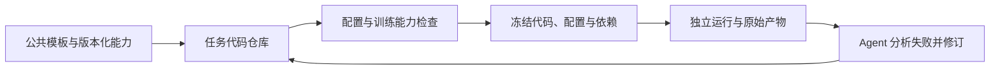

# PathoReason 独立任务代码仓库与冻结执行规划

日期：2026-11-01。状态：规划交接，尚未实施本文件中的新机制。

## 1. 用户目标与本次交接范围

PathoReason 提供病理研究的公共链路、常用工具、Skill 和执行器。具体研究任务应能复用这些模块，并获得独立的代码修正与适配环境。用户以前采用过“公共模板仓库 + 每次独立实验的代码副本”设计，希望在当前平台落实这一能力。

本文件将上述目标整理为实施方案。用户本次要求是“落实成文件，另开窗口执行”；本窗口只新增此规划文件，不实施代码改造、部署、训练、研究产物迁移或预算变更。后续窗口根据用户当时的实施指令继续，同范围既有授权不重复索取。

长期原则见 [通用开发与能力验证规则](../DEVELOPMENT_PRINCIPLES.md)：开发助手改进公共系统能力；研究 Agent 自行修改其任务代码并验证。不得由开发助手直接改研究脚本、指标、报告或已登记成果来替代 Agent 完成研究。原始失败、输出、测试暴露和预算消耗保留。

## 2. 已核对的现状

只读核对位置：`bxn-server:/home/bxn/projects/PathoReason`，分支 `PathoReason`。核对时最新提交为 `64772aa`，存在其他窗口正在进行的未提交改动；该提交不是后续实施时应强制回退的基线。

| 能力 | 当前证据与范围 |
| --- | --- |
| 公共能力库 | `src/pathoreason/`、`skills/`、`.agents/skills/`，以及只读引用的旧 `auto-research` 引擎 |
| 正式项目独立目录 | `formal.py` 创建 `projects/<project_id>`，含 inputs、plans、runs、manuscript、figures、outputs 等；保存 study.json、AGENTS.md 和独立 compute 配置 |
| 合成任务源码投影 | P2 的 `business_job.py` 调用旧引擎 `prepare_development(..., layout='native_allowlist')`，复制限定源码、绑定摘要并执行隔离检查 |
| P2 业务控制 | `business_worker.py` 复用原有控制器、回执和完整矩阵机制；已验收范围是固定 CPU 合成任务 |
| P5 GPU 启动绑定 | `compute_exec.py` 校验当前回合与冻结 GPU 配置，设置设备环境；不是通用任务代码快照或完整科学隔离器 |
| 真实任务独立 Git 仓库 | P5 项目创建流程未统一初始化任务仓库、导入版本化模板、登记任务代码修订 |
| 真实任务统一冻结执行 | 尚未形成“任务代码修订 → 检查证据 → 不可变快照 → 运行”的统一入口 |

源码入口：

- [formal.py](../../src/pathoreason/formal.py)
- [business_job.py](../../src/pathoreason/business_job.py)
- [business_worker.py](../../src/pathoreason/business_worker.py)
- [compute_exec.py](../../src/pathoreason/compute_exec.py)
- [P2 实施与范围](../p2/IMPLEMENTATION.md)

核对时主窗口正在新增公共 MIL 构建和预检查工具，涉及 `src/pathoreason/mil_execution.py`、`scripts/mil_preflight.py`、benchmark-design 的执行准备参考和相关测试。后续窗口先检查其最终提交、文档和验收结果再复用，不能把本文件写作时的未提交状态当作已发布能力。

同样保留现有 `docs/p5/OPERATOR.md`、`docs/p5/FXIO.md` 等其他窗口改动；不得覆盖、清理、重置或将其混入本任务提交。

## 3. 目标架构与对象边界

逻辑上保留两个主体：公共模板与能力库、独立任务代码仓库。运行时增加不可变执行快照。



- **Project**：研究空间，可包含多个研究任务与对话。
- **Task**：具有明确研究目标和协议的独立任务，拥有一个可修改的代码仓库。任务不等同于对话；同一任务可跨对话接续。
- **Code revision**：任务代码的一次可追踪修订。记录 Git commit、内容摘要、来源模板和修改来源。
- **Snapshot**：用于某次执行的完整不可变代码、配置及依赖绑定，可被多个兼容运行只读复用。
- **Run / unit / attempt**：分别承接现有运行、矩阵单元和尝试语义；实施时先核对已有契约，避免再造同义状态与独立预算账本。

任务目标改变（例如二分类切换为风险分级）通常创建新任务，并记录父任务及可复用的数据/方案引用；同一任务调整实现、修复错误或更换训练种子通常产生新修订或新运行。存在科学范围歧义时聚焦澄清，不靠关键词机械判定。

一个任务的各模型、种子不必分别复制完整 Git 历史。可共用经过冻结的代码快照，各自拥有配置、输出和回执。不同任务不能共享可写代码树或可变的依赖环境。

## 4. 存储与仓库内容

建议布局，最终通过现有 storage 配置解析根路径：

```text
/home/bxn/projects/PathoReason/
  templates/<template_id>/                 公共模板源码与版本清单
  src/pathoreason/                         平台控制能力
  skills/                                 公共流程指引

/data/bxn/PathoReason/projects/<project_id>/
  tasks/<task_id>/
    code/                                 独立 Git 仓库，供 Agent 适配
    task.json                             可读任务投影，非权限或预算真源

/data/bxn/PathoReason/studies/<project_id>/
  tasks/<task_id>/
    snapshots/<content_digest>/           执行器管理的冻结代码/配置
    runs/<run_id>/                        日志、检查点、指标、原始回执

/data/bxn/PathoReason/acceptance/<unique_id>/
                                          隔离工程与行为验收证据
```

权威任务状态、授权、预算、冻结登记和运行身份放在平台管理的持久化层，按现有事务与事件机制接入。Agent 可写目录内的 JSON 仅作为投影/工作材料，不能改一个字段就获得权限或将失败标成成功。

任务 Git 仓库保存训练入口、模型适配、数据转换代码、任务配置模板、依赖锁定信息、任务说明和测试。数据清单若含患者明细，继续存放在受控输入目录，代码只保存引用与摘要；不要因引入 Git 将敏感数据纳入代码历史。

不复制平台服务全仓库、凭据、虚拟环境、大特征、检查点或历史实验。数据集通过受控清单引用，运行产物留在数据盘。公共共享缓存仅用于内容寻址且不可变的数据；不得使用可写硬链接或指向可变共享源码的软链接冒充独立副本。

独立任务 Git 仓库仅用于本机版本记录，不自动创建远程仓库或推送代码。复制工具采用明确的模板文件清单，拒绝路径越界与不受控外链；保留第三方实现的来源、版本和许可证。

## 5. 模板、依赖与可修改范围

### 5.1 首个模板

先实现病理 MIL 分类模板，覆盖数据加载接口、显式模型构建、训练入口、评价接口、合成预检查及运行配置。复用主窗口修复后的公共组件和已有控制机制，不重新发明第二套超参数解释、预算计时或任务调度。

模板清单至少包含：template_id、版本、来源提交与摘要、允许导入的文件、入口、支持的任务/模型、输入输出契约、依赖锁定与可用性、验证范围。尚缺适配的模型返回结构化缺口；不能据此静默缩减用户已选择的 benchmark。

### 5.2 代码与环境独立性

研究 Agent 可以修改任务内模型、训练实现、数据转换、任务配置、任务说明和任务局部 Skill。平台保护授权、预算、状态与冻结记录。任务说明不能覆盖平台权限或研究约束。

可复用组件有两种导入方式：需要适配的源码按清单复制进任务仓库；稳定依赖以不可变版本引用。两者均记录来源，运行时不能继续导入随公共工作区变化的实现。

避免仅锁定代码而遗漏 Python 环境：记录锁文件、解释器/依赖版本和环境摘要；需要新依赖时使用独立版本环境或不可变可复用环境。不得通过修改共享虚拟环境影响其他任务。环境准备与实际训练分别记录成本及授权范围。

公共 Skill 的加载版本和摘要记录进运行来源；任务局部说明随任务代码版本保存。平台执行门禁保持外部控制，不能作为可删改模板文件交给任务仓库自行决定。

### 5.3 评价协议

评价逻辑可以因研究需求提出新版本，但必须登记协议差异并重新检查。历史指标仍绑定原评价版本。已使用的测试数据保持暴露记录，不能通过新建仓库或新运行宣称重新封存、从未使用。

## 6. 核心操作与一致性要求

以下是拟议语义，不代表现有 API 已支持；具体 API/工具名称按现有契约统一。

| 操作 | 输入与结果 | 必须处理的边界 |
| --- | --- | --- |
| create_task | 项目、模板版本、任务目标与父任务引用；返回任务身份与独立仓库 | 幂等创建、复制失败回退、模板来源验证，不复制整个研究空间 |
| check_task | 当前代码、配置、输入清单与环境；返回检查证据和适配缺口 | 不改研究结果；配置、代码、依赖或输入变化后证据失效 |
| freeze_task | 已检查的确定修订；返回不可变 snapshot_id | 捕获执行所需全部文件；拒绝遗漏的未跟踪文件、脏状态歧义及快照构建竞态 |
| launch_run | 冻结快照、矩阵/单元配置、既有授权与预算绑定 | 不从可写工作目录启动；幂等、设备绑定、真实状态和停止/恢复回执 |
| revise_task | 当前任务及反馈；打开新代码修订 | 原运行、失败和输出保留；修改后重新检查冻结 |
| inspect_update | 公共模板新版与任务来源 | 生成差异和兼容性说明；由 Agent 应用到新修订，不热替换运行代码 |

关键不变量：

1. 启动前核对快照字节、配置、环境、输入清单及预检查绑定；Git commit 本身不足以证明实际运行字节。
2. 训练工作进程从冻结快照加载代码；任务仓库继续修改时，正在运行的进程不受影响。
3. 续跑同一运行必须使用原冻结代码/协议/检查点关系。代码修改后的尝试生成新运行或明确的新尝试关系，并继续扣除适用预算，不重置历史消耗。
4. 不确定是否派发成功时先核对，不重复启动。后台作业独立于模型回合；回合结束不等于训练结束。
5. 目录规划、文件摘要和 chmod 不是完整安全隔离证明。运行时要落实写入范围、数据可见范围和测试集访问控制；优先复用并验证现有隔离机制。若当前阶段未接通，只能报告“仓库/快照能力完成”，不能声称完整隔离执行。
6. 配置、模型和训练入口在 smoke 与正式执行中共用，测试数据不参与训练准备或按 epoch 的模型选择。
7. 代码修改者、模板版本、Agent/人工来源、触发回合和检查证据均可追踪。工程检查、模型行为和科学审核分别呈现。

同一任务被多个对话同时修改时，需要任务编辑锁或 expected_revision 冲突检测；不得仅依赖文件修改时间决定谁的结果生效。

## 7. 公共修复与任务修复的关系

公共版本修复后，平台提示受影响任务存在更新，提供版本差异。研究 Agent 在任务的新修订中应用并验证，不自动重写当前任务代码，不修改正在运行的快照。

任务适配若具有复用价值，另开公共工程变更，经代表性回归后发布模板版本。保留原作者、任务来源和验证范围，不能将某个病种的特殊选择无条件提升为全局默认。

当前研究接入新机制时，由研究 Agent 创建新任务版本并引用旧方案/输入；开发者不替其改现有训练脚本或产物。既有文件不搬走、不覆盖、不伪装成新机制产生的历史记录。历史来源未知时显式记录未知。

## 8. 分阶段实施与验收

### 第一阶段：独立任务仓库

交付：模板清单、任务注册与幂等创建、独立 Git 初始化、来源记录、存储分工、任务修订与并发冲突控制。提供真实可调用的工具入口，接入当前项目与对话身份。

验收：两个任务从同一模板创建后互不影响；任务修改不改变公共模板；重复请求不产生重复任务；失败创建无假成功记录；凭据、大数据、检查点不进入代码副本；父任务来源与现有项目状态保持完整。

阶段边界：仓库创建成功不等于训练可启动，不提前宣称完整执行隔离。

### 第二阶段：冻结与统一执行

交付：完整快照、检查证据绑定、依赖环境绑定、统一训练入口、后台运行状态/停止/恢复，以及现有矩阵、预算、GPU、测试隔离的接入。优先复用已有能力；必须新增的执行后端明确标注其支持范围。

验收：冻结后修改任务代码不改变运行；未跟踪的执行依赖不能漏入快照；快照/输入/环境变化会拒绝复用旧检查；任务代码不能改权威预算与状态；重试不覆盖原产物；重复启动被拒绝；异常退出与未知派发可核对；训练进程不能访问封存测试特征；预算截止和停止确实终止对应作业。

先使用隔离合成输入完成这些证明，再考虑真实项目。GPU 验收只在明确资源和预算范围内运行，不碰其他任务。

### 第三阶段：自然语言接入与模板更新

交付：Agent 能按当前任务选择/复用模板，创建或修订任务仓库，运行检查并引用真实回执；界面以任务进度和下一步为中心展示版本差异与可用更新。界面修改前阅读根目录 design.md。

行为验收至少包含：“用现有方案开始”“这个任务换成风险分级”“修好后再试”“沿用刚才的设置”“更新公共修复”等短句。按真实上下文区分新任务、新修订、继续运行和必要澄清，不要求用户填写 Git、SHA 或完整技术指令。

验收由 OpenCode + 目标基模在独立合成项目中自行操作。记录模型、模板、工具版本、预算、失败及人工介入；预先明确有界验收额度，不重置历史项目预算。之后才在用户授权范围内由研究 Agent 接入现有研究任务。

## 9. 实施入口与建议改动位置

先读 AGENTS.md、EXECUTION_PLAN.md、本文件和通用开发规则，核对最新提交、主窗口改动、当前活动任务及部署版本。

- 在 `src/pathoreason/` 实现任务代码/快照服务，复用现有 persistence、storage 和业务事件接口。
- 在 `templates/` 保存最小可执行模板及清单；不要将整个旧仓库作为默认复制对象。
- 在现有工具/MCP/正式研究入口接入任务身份与操作；保持当前权限、expected_revision、幂等与预算语义。
- 在研究执行层绑定快照，复用/扩展已有后台任务与回执机制。`compute_exec.py` 的 GPU 选择能力继续保留，不将其误当完整执行器。
- 在 Skill 中提供选择模板、适配、检查、冻结和失败修订指引；确定性的复制/校验/登记进入工具。
- 通过增量契约与数据库迁移记录新对象，保留旧项目、旧契约、旧运行记录；现有项目不强制迁移。
- 在专用测试与 acceptance 目录保存隔离验证证据，禁止借修改真实研究输出“通过”验收。

本规划不要求创建源码工作树或同级仓库副本。后续窗口按仓库当前规则开展开发，先确认并发编辑边界；本文件不构成覆盖其他窗口未提交变更的授权。

## 10. 发布、回退与完成标准

每阶段记录实际交付与未实现范围。发布前核对应用回合、原生会话、上下文操作、待审批与研究后台作业；不能因模型 idle 就认定研究任务全部空闲。仅在受影响服务可安全更新时发布，不中断已有研究。

回退采用兼容的代码/功能开关方案，保留新增任务、修订、回执和预算；不得恢复旧数据库抹掉研究证据。运行中的快照与环境版本不受公共代码回退影响。

最终交付至少包括：

- 可创建并适配的独立任务仓库及可追踪的模板来源。
- 从已检查且冻结的版本执行，运行与后续代码修改相互独立。
- 失败后由 Agent 形成新修订并重试，原证据与消耗保留。
- 公共更新可被任务选择性应用；不热修改运行或批量重写旧任务。
- 工程、原生集成、目标基模行为和科学审核结论分别记录。
- 现有研究的原脚本、结果和失败记录未由开发助手改写。

## 11. 新窗口可直接使用的指令

> 连接 bxn-server，在 /home/bxn/projects/PathoReason 阅读 AGENTS.md 和 docs/p5/TASK_CODE_WORKSPACES_PLAN.md，按该规划实施独立任务代码仓库与冻结执行能力。先核对主窗口公共 MIL 修复的最终状态和并发改动，优先复用已有工具与控制器。按三个阶段完成实现及相应验收，记录每阶段范围，不以第一阶段完成冒称完整执行能力。保持真实研究脚本、产物、原失败和预算不变，由目标 Agent 在隔离验收任务中证明新能力；真实研究接入仍由研究 Agent 自行形成新版本。不要覆盖其他窗口修改或中断现有作业。

该启动指令供用户在新窗口主动发送；本文件本身不触发实施、调用模型或启动训练。
