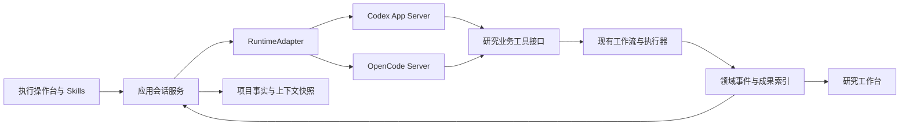

# Agent 执行操作台改造规划 v0.1

日期：2026-10-30。状态：需求与接口提案，尚未进入产品代码改造。

本轮依据用户新增四点需求：左侧平铺 Skills 场景；首轮可使用 Codex CLI；明确 OpenCode 自选基模的上下文/压缩机制；盘点原 Schema，为后续调整留出边界。延续先前定位：执行通过 Agent 对话，研究工作台展示阶段与成果，现有研究流程保持。

## 结论与首轮范围

建议保留统一前端，后端新增一个会话服务，分别接 Codex App Server 与 OpenCode Server。首轮以 Codex 作为真实执行运行时，先验收一个受支持场景，随后接入 OpenCode。既有一次性 AgentRequest/ConfiguredAgentExecutor 继续承接旧阶段任务；新增长期会话适配器，避免强行改变所有旧 runner 的契约。

这里将“前端还是套 Codex CLI”理解为：继续使用新网页界面，网页背后的 Agent 由 Codex CLI 提供。终端 TUI 不作为网页协议；浏览器通过应用服务访问 CLI 的结构化接口。

当前没有修改 App、运行时、业务 Schema、数据库或已有实验，也没有调用收费模型。方案中的新对象和路由均为建议名称。

## 1. 左侧 Skills：规范化场景目录

左侧维持工具入口、Skills 栏与项目/会话列表。Skills 使用一层平铺条目，可搜索；点击展示简短场景说明、所需材料、典型产物和当前可用状态，并将技能引用与输入需求带入当前对话。未选项目时创建/选择项目后继续；缺失数据通过对话补齐。点击条目本身不提交训练。

建议首批目录如下，名字可改，执行范围依据后端注册能力与当前环境动态判断。

| 场景条目 | 输入与产出 | 已有实现依据 | 首轮处理 |
|---|---|---|---|
| 数据接入与任务定义 | 数据位置、标签、目标 → 数据/任务定义与准备记录 | dataset_intake、prepared_dataset_control、TaskSpec | 复用接入逻辑；补齐项目关联 |
| 病理 MIL 基线研究 | 任务与模型要求 → 方案、完整折次结果 | 五类 MIL 模板、task_capabilities、auto_mil | 展示任务族；支持程度按具体组合判断 |
| 机制假设与消融研究 | 基线证据、假设、预算 → 候选、消融、复验 | performance_loop、module_discovery | 标注已注册模块范围；独立脚本成果不冒称已通用化 |
| 结果解读与研究汇报 | 已有实验表/图 → 可追溯解释与报告 | research_reporting、ResearchResults、task_supervisor | 推荐首轮真实对话验收场景 |
| 研究成果转论文 | 方法与结果 → 正文、引用、作者待补项 | manuscript_pipeline、method-results-to-manuscript | 用已有成果进行受控验收，避免混入新训练 |
| 图件与论文排版 | 图表输入、正文 → 图件、PDF、源码包 | pathology-mil-paper-figures、manuscript-to-latex | 环境/输入要求独立显示 |
| 实验排障与恢复 | 失败记录、用户要求 → 修复、验证、恢复记录 | workbench registry、WorkspaceJobs | 复用已有恢复范围与幂等机制 |

已有 13 个仓库顶层 SKILL.md；它们可作为场景的实现依赖，但不直接等同于 13 个已验收产品功能。`CapabilitySpec`、`RepairRegistry`、`TaskCapability` 和 `TemplateManifest` 各有职责，不应仅扫描 Markdown 就显示“可执行”。文献库/联网检索等已有暂缓项不因展示 Skills 而自动实施或启用。

建议新增 SkillDefinition（命名待定）：

- 身份：id、version、title、description、tags。
- 契约：input_schema_ref、output_schema_ref、workflow_template_refs、capability_refs。
- 运行：runtime_support、instruction_refs、required_inputs、required_tools。
- 可用性：implementation_status、evidence_scope、runtime_readiness、unavailable_reason；把“有实现”“通过何种验收”“当前环境可运行”分开。
- 运行记录固定 skill_id + version + digest。旧会话重放使用原技能版本，不随目录升级漂移。

同一产品 Skill 可映射多个原生 Skill 和业务能力。Codex 与 OpenCode 加载协议分别适配；不假设同名 SKILL.md 在两个 runtime 下工具能力完全一致。

## 2. Codex CLI 首轮兼容

实机已确认：codex-cli 0.164.0，支持 `app-server`。由该二进制实际导出 320 个 JSON Schema 文件，未启动推理；其默认协议包含 thread/start、thread/resume、turn/start、turn/interrupt、thread/compact/start、skills/list、model/list。

推荐服务端托管 `codex app-server --stdio`，经应用服务统一对浏览器提供请求和事件流。应用记录 project_id / conversation_id 与原生 thread_id 的绑定；恢复用明确 ID，不使用全局 `--last`。

| 产品能力 | Codex 路径 | 接入工作 |
|---|---|---|
| 新会话、恢复 | thread/start、thread/resume | 持久绑定及项目隔离 |
| 发送/停止 | turn/start、turn/interrupt | 回合状态、停止回执、取消与任务停止分开 |
| 流式回复与工具活动 | item / turn 事件 | 标准事件、断线补读、错误分类 |
| Skill 目录/调用 | skills/list、skill 输入项 | 产品 Skill 映射、按版本注入 |
| 模型选择 | model/list、turn/start.model | 会话级选择、实际可用列表、调用级快照 |
| 上下文统计/压缩 | token usage 通知、thread/compact/start | 统计口径、压缩状态、失败处理 |
| 命令/编辑确认 | server-initiated approval requests | 与应用已有科研决定分开记录 |

官方仍将 App Server 命令/部分传输标为实验性。首轮固定 CLI 版本和实机导出协议，优先服务端 stdio；后续升级做协议兼容检查。现有 `codex exec --json` + 显式 session resume 可作为兼容路径，但交互确认和中途输入能力需独立验证，不能宣称与 App Server 全量等价。

已有 `ConfiguredAgentExecutor` 是单次产物边界：构造调用、等待结束、解析最终回答、Schema 验证后原子发布。现有 WorkspaceJobs 已有 fault_sessions、历史与事件，但其 conversation() 只拼最近 6 条结果（每条回答最多 6000 字符），且有历史长度限制；它不是 Codex/OpenCode 原生连续会话。保留它的审计与目标绑定能力，不把排障的 summary/resume_ready JSON 强套给一般聊天。

建议 RuntimeAdapter 能力接口：create_session、resume_session、start_turn、interrupt_turn、events、list_models、list_skills、compact、capabilities。把 steer、fork、usage_details、tool_approval 等可选能力显式声明，前端据此显示，不用空实现假装支持。认证使用部署端现有支持方式，实际账户与模型列表在首轮联调核对；本轮未变更账号或凭据。

## 3. OpenCode 的上下文和压缩如何生效

实机 OpenCode 1.18.33；项目锁定版本也为 1.18.33。核对官方文档及该 tag 源码，区分以下三层：

1. 浏览器历史：用户看到的消息、执行摘要、引用和事件，应用持久保存。
2. 运行时上下文：送入模型的 instructions、已加载 Skill、消息、工具输出与压缩摘要，由 OpenCode session 管理。
3. 研究事实：目标、数据绑定、模板、预算、已完成单元、审核决定和产物索引，仍由应用契约/账本保存。压缩后的文字不能替代这些事实。

当前 OpenCode adapter 每次运行 `opencode run --pure --format json ...`，没有传 `--session`；默认 bwrap 使用临时 HOME / XDG_DATA_HOME。因而一次调用内部可使用 runtime 行为，但跨用户消息不能依靠该路径获得稳定的原生会话延续。`--pure` 在此版本表示禁用外部插件，不等同于禁用压缩。

接入方式建议：服务端托管 OpenCode Server 或绑定持久运行环境，保存明确 session_id，并为会话数据配置专属持久存储；保留既有工作目录与写范围约束。使用 session/message、prompt_async、abort、events 等接口（具体路径按锁定版本 OpenAPI 验收）。应用重连先核对原回合状态，避免网络重试变成重复执行。

压缩机制：

- 开启 `compaction.auto` 时，运行时按模型 context/input/output 限额、token 用量与预留空间决定是否需要压缩；不是所有模型统一到某个固定 token 数触发。
- 该版本 overflow.ts 中，context=0 会跳过自动溢出判定。自选模型必须核对上下文窗口、输入/输出上限和服务商返回用量；不能只配置任意 model 字符串。
- 隐藏的 compaction agent 汇总较早上下文，保留近期部分后继续；可另外配置压缩模型，否则源码使用用户消息所选模型。另选压缩模型也必须能容纳待摘要输入，并核验费用与输出质量。
- `prune` 与摘要压缩不同：它可减少较老的工具输出进入后续上下文。当前文档与版本源码为显式启用，不应沿用其他版本默认值。
- 手动压缩可通过 session summarize 接口触发。上下文窗口未知、用量不可靠、摘要失败或摘要仍超限时，需要显示可恢复错误，不自动重放已经执行的业务动作。
- 压缩有模型调用成本和信息损失，不能承诺无限记忆。UI 显示运行时报告的用量或明确标注估算值、最近压缩时间、压缩中/失败状态与来源引用；不把累计计费用量当当前窗口占用。

项目当前动态 provider 配置仅写 `models[model].name`，没有显式 context/input/output 限额，也没有 compaction 配置。部分已知模型可能从 runtime 目录获得元数据，但任意自选模型不能假定如此。这是 OpenCode 接入前必须补齐的验证项。

建议应用增加 ContextSnapshot：当前研究目标、已确认约束及原话来源、正在执行的任务、关键决定、待处理项、产物索引和 revision。每回合按需取最新事实与相关片段，压缩后仍可重取；不把整个历史/所有 Skill/全部论文重新塞入提示词。应用层项目摘要与运行时原生压缩分工清晰，首版不同时实现两套抢占式历史压缩器。

模型切换规则建议：同一 runtime 内下一回合生效；先核对新模型窗口和工具支持，必要时压缩或创建分支。Codex → OpenCode 属于 runtime 切换，不能移植 thread_id；新建原生会话，通过明确的项目快照/交接摘要续接，并保留旧原生历史。正在运行的回合固定其 runtime/model/config 快照。

## 4. Schema 梳理与调整边界

详见同目录 SCHEMA_REVIEW_20261030.md。主要发现：

- ExperimentConfig 同时容纳科研目标、旧标签字段、任务契约、计算环境、预算、论文设置和优化扩展，适合旧执行入口，不适合直接成为新会话模型。
- ProjectBlueprint 同时持有工作流转换与 workspace 展示，且 executor 固定 legacy_mil；TaskProjectBlueprint v2 是另一条能力绑定/小规模掩膜评估项目路径，不等于通用 ResearchProject v2。
- 模板、能力声明、执行尝试、科学判定、批准是不同实体。不能把聊天完成、工具成功、workflow完成、科研通过合并为一个 completed。
- 旧实验主记录是 JSON，工作流/排障/研究循环/记忆分别用 SQLite。不能把“梳理 Schema”简化为迁移一张数据库表。
- 前端存在手写类型，API 中还有 dict 与动态 JSON Schema，OpenAPI 不是完整内部契约清单。

建议先增加会话/目录/展示层契约，旧领域契约通过适配器使用，再单独决定 ExperimentConfig、工作流结构与业务目标是否拆分。旧实例冻结模板、配置与哈希保持原样，不对历史数据隐式补默认值并重写摘要。

## 5. 建议架构

“业务工具接口”可用 MCP/受控工具桥实现，选型在第一阶段验证。Agent 提出和调用现有业务操作，服务端核对目标修订、幂等键及现有预算/门禁后执行。研究工作台订阅领域状态，不靠解析自然语言修改阶段。例行解释和已授权操作保持自然对话；需要补充材料、改变预算或科研确认时，用对话内结构化卡片承载。

停止对话回合与停止长期训练分别显示并绑定目标。浏览器切换/关闭不杀后台运行；重新打开先重连已有任务。无需为界面效果把训练进程生命周期绑到 CLI 单次请求。

## 6. 分步实施与验收

| 阶段 | 交付 | 验收重点 |
|---|---|---|
| P0 契约定稿 | SkillDefinition / ResearchProject / Conversation / RuntimeBinding / Event / ArtifactIndex 的最小定义；原契约映射 | 样例可验证；同名概念与状态含义一致；列出需迁移与原样引用字段 |
| P1 Codex 真会话 | 左侧 Skills、项目、多会话；真实流式对话、停止、重连、技能调用 | 结果解读场景读取已有 CESC 材料；正确引用并打开成果；两项目隔离；刷新/后台切换不重复调用 |
| P2 研究工具接入 | 对话驱动既有工作流；研究工作台只读投影 | 用独立合成小任务走一次状态与产物闭环；重复请求不重复执行；修改意见生成可核验修订 |
| P3 OpenCode 兼容 | 同一 UI 切换 runtime/provider/model、持久 session、压缩事件 | 两种已配置模型；原生恢复、自动/手动压缩、切小窗口、工具调用、错误/断流；费用与使用量口径正确 |
| P4 Schema 调整与迁移 | 按已确认差异改领域契约；历史读取适配/显式新修订 | 历史样本不丢字段、不变原哈希；新旧结果一致；失败可回退旧入口 |

上下文验收要有可观察标准：固定研究目标和已有约束、执行一次工具动作、形成产物引用，触发压缩后仍能定位原证据且不会重复执行；摘要错误时从事实层恢复。真实厂商验证需使用已配置账号与明确测试开销，不以合成协议测试替代真实质量验收。

本规划不预估未经实测的开发天数。P0/P1 的反馈可能改变后续 Schema，不在当前就锁定大型数据库重写。

## 待进一步定稿的产品决定

- Skills 是否允许用户上传自定义技能：建议首版只提供审核过的场景目录，保留扩展接口。
- 一个研究项目是否承载多实验/多稿件：建议允许，conversation 与 workflow_instance 分别关联项目，不强制一项目一实验。
- runtime 切换是否显示为新分支：建议显示“已切换执行引擎，沿用项目上下文”，保留历史分界。
- 首轮认证、可用模型、真实调用额度：接入前核对现有部署，凭据不写入会话记录。

## 来源与验证范围

仓库读取与协议导出日期：2026-10-30；Git HEAD 55a1921，工作树含已有未提交改动，实际依据为当前文件。证据目录：/data/bxn/auto-research/acceptance/agent-console-planning-20261030；包括 schema-inventory.json、openapi.json、codex-schema/、codex-compatibility.json。

[Codex App Server 官方文档](https://learn.chatgpt.com/docs/app-server)；[Codex 非交互模式](https://learn.chatgpt.com/docs/non-interactive-mode)；[OpenCode Server](https://opencode.ai/docs/server/)；[OpenCode 配置](https://opencode.ai/docs/config/)；[OpenCode Skills](https://opencode.ai/docs/skills/)；[OpenCode v1.18.33 compaction 源码](https://github.com/anomalyco/opencode/blob/v1.18.33/packages/opencode/src/session/compaction.ts)；[OpenCode v1.18.33 overflow 源码](https://github.com/anomalyco/opencode/blob/v1.18.33/packages/opencode/src/session/overflow.ts)。

本轮验证为静态源码/实机协议/在线官方资料核对，不代表新网页已接上真实引擎，也没有执行完整数据库数据审计。
